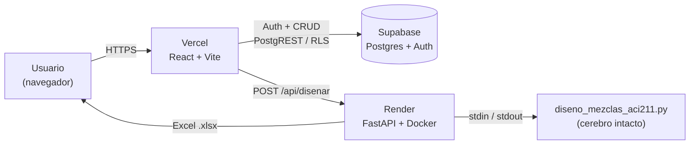

# Diseño de Mezclas de Concreto — ACI 211


> **Servidores en producción:** **Frontend → Vercel** · **Backend → Render** · **Base de datos → Supabase**

Calculadora de dosificación de concreto (f'c 100–1000 kg/cm²) por el método **ACI 211**.
El cálculo lo realiza `diseno_mezclas_aci211.py`, un programa de consola interactivo que
genera el informe técnico en Excel con openpyxl. **Ese archivo no se modifica nunca.**

## Servidores en producción

| Componente | Servidor | Qué corre allí | URL |
|---|---|---|---|
| **Frontend** | **Vercel** | React + Vite compilado (`web/frontend`) | https://aci211-diseno-mezclas.vercel.app |
| **Backend** | **Render** | FastAPI + `diseno_mezclas_aci211.py` en Docker (plan free, Virginia) | https://aci211-diseno-mezclas.onrender.com |
| **Base de datos** | **Supabase** | Postgres, Auth y políticas RLS (tabla `disenos`) | https://uiudnidegokdnnisjpho.supabase.co |

- El **frontend** se sirve únicamente desde **Vercel**.
- El **backend** se ejecuta únicamente en **Render** (la función serverless de Vercel queda solo como respaldo).
- **Supabase** no ejecuta Python: únicamente autentica usuarios y guarda los diseños.

### Enlaces útiles

| Recurso | URL |
|---|---|
| Salud de la API | https://aci211-diseno-mezclas.onrender.com/api/health |
| Documentación FastAPI | https://aci211-diseno-mezclas.onrender.com/docs |
| Repositorio | https://github.com/coli2233/aci211-diseno-mezclas |

## Arquitectura



| Capa | Tecnología | Plataforma | Responsabilidad |
|---|---|---|---|
| Frontend | React + Vite | **Vercel** | Formulario, resultados, login e historial |
| Backend | FastAPI + Python 3.12 + numpy / pandas / openpyxl | **Render** (Docker, plan free) | Ejecuta el cerebro y devuelve JSON + Excel |
| Datos | Postgres + Auth + RLS | **Supabase** | Usuarios y tabla `disenos` aislada por usuario |
| Cálculo | `diseno_mezclas_aci211.py` | Dentro de Render | Programa original, sin cambios |

### Flujo de una consulta

1. El usuario completa el formulario en **Vercel**.
2. El navegador hace `POST https://aci211-diseno-mezclas.onrender.com/api/disenar`.
3. **Render** ejecuta el cerebro como proceso hijo y le envía las respuestas por `stdin`.
4. La API parsea la salida de consola y devuelve `datos`, `dosificacion` e `informe`.
5. Si hay sesión, el frontend guarda la ficha en **Supabase** (`disenos`); las políticas RLS garantizan que cada usuario solo vea sus propios diseños.

## Estructura del repositorio

```text
.
├── diseno_mezclas_aci211.py      # Cerebro ACI 211 (intacto)
├── Dockerfile                    # Imagen de la API para Render
├── .dockerignore
├── README.md
└── web/
    ├── backend/                  # FastAPI: api.py + requirements.txt
    ├── frontend/                 # React + Vite
    │   ├── api/                  # Función serverless de respaldo en Vercel
    │   └── src/
    └── supabase/
        └── schema.sql            # Tabla disenos + políticas RLS
```

## Despliegue

### 1. Supabase — base de datos y autenticación

1. Ejecutar `web/supabase/schema.sql` en el **SQL Editor**.
2. Activar Auth por email/contraseña.
3. La clave **publishable** puede viajar al navegador; la protección real está en las políticas **RLS**.

### 2. Render — backend Python

1. **New → Web Service** → repo `coli2233/aci211-diseno-mezclas`.
2. Runtime **Docker** (usa el `Dockerfile` de la raíz), plan **Free**, región **Virginia**.
3. **Health Check Path:** `/api/health`.
4. Variable de entorno:
   - `CORS_ORIGINS=https://aci211-diseno-mezclas.vercel.app`
5. Render inyecta `PORT`; el `Dockerfile` lo respeta.
6. URL resultante: `https://aci211-diseno-mezclas.onrender.com`.

### 3. Vercel — frontend React

1. **Root Directory:** `web/frontend`.
2. **Build:** `npm run build` → `dist`.
3. Variables de entorno:
   - `VITE_API_URL=https://aci211-diseno-mezclas.onrender.com`
   - `VITE_SUPABASE_URL=https://uiudnidegokdnnisjpho.supabase.co`
   - `VITE_SUPABASE_ANON_KEY=<publishable key>`
4. **Importante:** Vite incrusta las variables en el build; después de cambiarlas hay que **redeploy**.

## API

| Método | Ruta | Descripción |
|---|---|---|
| GET | `/api/health` | Estado del servicio y del cerebro |
| POST | `/api/disenar` | Ejecuta el diseño y devuelve JSON |
| GET | `/api/informes/{archivo}` | Descarga el Excel generado |
| GET | `/docs` | Swagger UI de FastAPI |

Ejemplo:

```bash
curl -X POST https://aci211-diseno-mezclas.onrender.com/api/disenar \
  -H "Content-Type: application/json" \
  -d '{
    "descripcion": "losa de concreto",
    "fc": 210,
    "responsable": "Equipo 6",
    "consistencia": "2",
    "aire": false,
    "tipo_cemento": "Andino Tipo V",
    "pe_cemento": 3.12,
    "arena": {"puss": 1580, "pucs": 1710, "pe": 2.65, "humedad": 3.5, "absorcion": 1.2, "mf": 2.7},
    "piedra": {"puss": 1550, "pucs": 1660, "pe": 2.62, "humedad": 0.4, "absorcion": 1.0},
    "tmn": "3",
    "probeta": {"diametro": 15, "altura": 30, "numero": 3, "desperdicio": 20},
    "confirmar": true,
    "informe": true
  }'
```

## Verificación en producción (20/11/2026)

| Prueba | Resultado |
|---|---|
| `GET /api/health` | `200` · `{"ok":true,"existe":true}` |
| `POST /api/disenar` con `fc=210` | `200` · `f'cr=294` · `a/c=0.56` |
| Descarga del Excel | `200` · 22 KB |
| Preflight CORS desde Vercel | `200` · `access-control-allow-origin` correcto |
| Frontend servido por Vercel | bundle con `aci211-diseno-mezclas.onrender.com` |

> Estas pruebas confirman que **Vercel (frontend)**, **Render (backend)** y **Supabase (datos)** están conectados en producción.

## Notas y limitaciones

- **Cold start:** el plan free de Render duerme tras 15 minutos sin tráfico; la primera petición puede tardar ~50 s.
- **Excel efímero:** el archivo se guarda en el disco del contenedor y se pierde al reiniciar. Para persistencia, subirlo a **Supabase Storage**.
- **Previews de Vercel:** `CORS_ORIGINS` solo permite el dominio de producción; las URLs de preview quedan bloqueadas.
- La función `web/frontend/api/disenar.py` se conserva como respaldo serverless, pero producción usa Render vía `VITE_API_URL`.
- **Regla de oro:** `diseno_mezclas_aci211.py` no se modifica.

## Desarrollo local

1. `python web/backend/api.py` → API en `http://127.0.0.1:8000` (también sirve el build de React).
2. `cd web/frontend && npm install && npm run build` (o `npm run dev` para HMR).
3. `web/iniciar_web.bat` automatiza ambos pasos.
4. Sin `VITE_API_URL`, el frontend usa el mismo origen (`/api/disenar`).

## Seguridad

- Las claves **nunca** se suben al repositorio: se configuran como variables de entorno en Vercel y Render.
- La clave publishable de Supabase es pública por diseño; la seguridad real está en las políticas **RLS**.
- No se debe commitear ningún archivo de credenciales.
